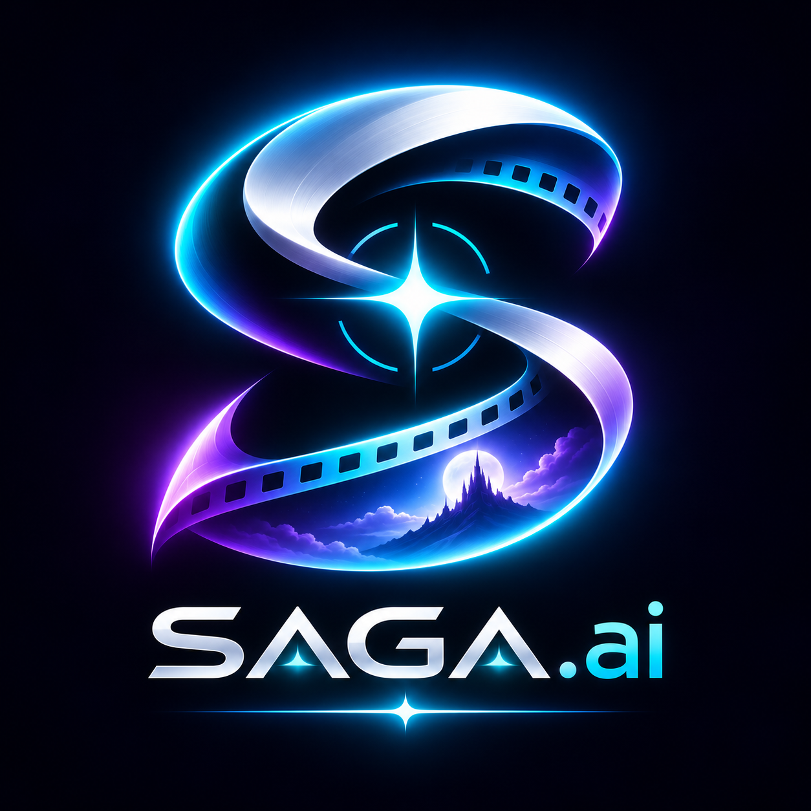

<p align="center"></p>

# SAGA.AI

**用手機丟一句靈感，自動生產整部 AI 直式短劇。全程免費。**

```
手機開 Issue（靈感）
   │  GitHub Actions ─ Gemini 免費 API
   ▼
劇本聖經 + 60 集大綱  ──→  Issue 留言回報
   │  你留言 /produce 1-3
   ▼
分鏡劇本（Gemini）→ 配音（Edge-TTS）→ 算圖（Kaggle 免費 GPU）→ 剪輯（FFmpeg）
   ▼
成片上傳到 Release，Issue 留言附下載連結
```

| 階段 | 工具 | 費用 |
|---|---|---|
| 編劇 | Google Gemini API（免費額度） | 0 |
| 配音 | Edge-TTS（多角色聲線） | 0 |
| 角色定妝＋分鏡圖 | SDXL + IP-Adapter（鎖臉），在 Kaggle T4 上跑 | 0（每週約 30 GPU 小時） |
| 關鍵鏡頭影片（選用） | Wan 2.2 TI2V 5B | 0（較耗 GPU 時數，實驗性） |
| 運鏡、字幕、配樂、合成 | FFmpeg，在 GitHub Actions 上跑 | 0（公開 repo 不限時數） |

成片形式為「動態漫」：大部分鏡頭是靜態圖加推拉搖移運鏡，配上多角色配音與燒錄字幕，1080×1920。

---

## 一次性設定（約 10 分鐘）

1. **Gemini API Key**：到 <https://aistudio.google.com/apikey> 建立。
2. **Kaggle**：
   - 註冊 <https://www.kaggle.com>，在 Settings 完成**手機驗證**（不驗證就不能開 GPU 與網路）。
   - Settings → API → Create New Token，下載 `kaggle.json`，裡面有 `username` 與 `key`。
3. **GitHub Secrets**：repo → Settings → Secrets and variables → Actions → New repository secret
   - `GEMINI_API_KEY`
   - `KAGGLE_USERNAME`
   - `KAGGLE_KEY`
4.（選用）**Variables** 加 `GEMINI_MODEL` 可指定模型；不設就用 `gemini-flash-latest`。

## 手機 App

打開 **<https://eastonesd.github.io/saga.ai/>**：
- Android／Chrome：選單 → 安裝應用程式
- iPhone／Safari：分享 → 加入主畫面

第一次開啟時貼上 GitHub fine-grained token（只選 saga.ai；Issues 讀寫、Contents 與 Actions 唯讀）。之後就能在 App 裡送靈感、下生產指令、看底片牆與播放成片，不必再開 GitHub App。

## 日常使用（GitHub 介面）

1. 手機打開 GitHub App → 這個 repo → Issues → New → **🎬 新劇靈感**，填靈感送出。
2. 幾分鐘後 Issue 會收到劇名、角色表、前 10 集大綱。
3. 在 Issue 留言：
   - `/produce 1-3`：生產第 1～3 集
   - `/produce 4-8 --video`：關鍵鏡頭也做成真影片
   - `/produce 5 --rewrite`：第 5 集整集重寫重做
4. 完成後 Issue 會附上成片下載連結。

> 每次建議 3～5 集。單次 Actions 上限 6 小時，算圖預算設為 4 小時；沒跑完的會在下次留言相同指令時接續。

## 本機試跑（不花任何額度）

```bash
pip install -r requirements.txt   # 另需 ffmpeg 與中文字型（Noto Sans CJK）
python -m saga.cli plan    --slug demo --idea "外送員撿到會預知未來的手機" --episodes 10 --mock
python -m saga.cli produce --slug demo --eps 1-2 --mock
# 成片：build/demo/demo-ep01.mp4
```

拿掉 `--mock` 並設好環境變數 `GEMINI_API_KEY`、`KAGGLE_USERNAME`、`KAGGLE_KEY` 就是正式生產。

## 檔案結構

```
saga/
  prompts.py        所有提示詞與短劇鐵律（改編劇風格改這裡）
  writer.py         劇本聖經、大綱、分鏡
  voice.py          配音
  render.py         打包算圖工作單、送 Kaggle、抓回結果
  kaggle_kernel.py  在 Kaggle GPU 上執行的算圖程式
  assemble.py       運鏡、字幕、配樂、合成
series/<slug>/      每部劇的劇本與角色定妝照（進版控）
assets/bgm/         放免版稅配樂
```

## 注意

- 這是**公開 repo**：劇本、定妝照與 Release 裡的成片任何人都看得到。workflow 只接受 repo 擁有者觸發。
- Edge-TTS 使用微軟非官方端點，屬灰色地帶；若要商用上架，建議換成可商用授權的 TTS。
- 模型預設值可用環境變數覆寫：`SAGA_IMAGE_MODEL`（例如換成動漫風 SDXL 模型）、`SAGA_VIDEO_MODEL`。
